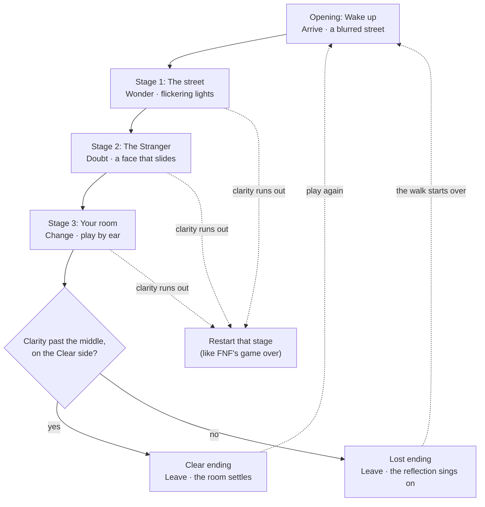

# Codex brief: "Hallucination Hysteria" game proposal page

This file lives in the repo at `docs/hallucination-hysteria-brief.md`. It is a working file, so don't link to it from the site. The images and audio it refers to are already committed in `assets/hallucination-hysteria/`.

---

## 0. Your task and ground rules

You are working in my class portfolio repository, which is hosted on GitHub Pages. Build **one new page**: a designed game proposal for my web game *Hallucination Hysteria*, presented to my instructor as a client. This is my Week 1 assignment for "AI for Design" (theme: Hallucination).

**Ground rules:**

1. **Do not publish yet.** This brief and the assets are already committed on `main`; nothing links to them yet, so the live site hasn't changed. Deliver your work as a pull request into `main`, and do not merge it or deploy until I explicitly say "publish." When you finish, show me screenshots of the page at desktop and phone widths if you can, list every file you added or changed, then stop and wait. When I do say "publish," tell me exactly what to click to merge the pull request (or merge it yourself if you can), then give me the live URL.
2. **Inspect the repo first.** Learn how existing pages are structured (shared header, navigation, footer, CSS files, fonts, folder layout, any build step) and follow those conventions. If the site is plain HTML/CSS/JS, keep this page plain too: no frameworks, no build step. If the site is served from a subfolder (such as `/docs`) or a build folder (such as `public/`), move `assets/hallucination-hysteria/` to where the site can serve it, update the paths, and tell me you did.
3. **Keep my portfolio's header and navigation** on this page, and add a link to the new page wherever the site lists its other projects or pages. Below the header, the page uses the Hallucination Hysteria theme described in section 2.
4. **Use only the content in this brief.** Do not invent facts, quotes, sources, credits or statistics. Section 8 has the page copy; use it as written (you may fix typos and adjust line breaks). If an asset is missing, show a clearly labeled placeholder instead of guessing.
5. **Respect the art rules.** Do not use any Friday Night Funkin' art, sprites, logos or audio other than the image files listed in section 4.1 (my screenshots and one cropped piece of the game's rating art), each with the credit given there. Do not copy images of Vib-Ribbon or Nighthawks; link to their sources instead. Everything you draw must be original.
6. **No autoplaying sound**, ever.
7. Suggested URL: follow the repo's existing pattern, e.g. `/hallucination-hysteria/` or `hallucination-hysteria.html`. Page title: "Hallucination Hysteria · Game Proposal".

---

## 1. Page structure and reading order

The page is a client presentation with a clear hierarchy and a deliberate reading order. It has a hero, then seven numbered parts in this order, then credits:

| # | Section nav label | Content |
| --- | --- | --- |
| Hero | (none) | Title, key art with the clarity slider, one-paragraph pitch |
| 01 | Game | Introduce the game |
| 02 | Research | Case study: Friday Night Funkin' |
| 03 | Your Insight | Critical discussion with AI |
| 04 | Narrative | Narrative and concept |
| 05 | Player Journey | Interaction and player journey: flowchart, stages, storyboard |
| 06 | Style + Sound | Style and sound guide, including track previews |
| 07 | Build Plan | Two-week build plan |
| End | Credits | Credits, sources, licenses |

Each part opens with a small numbered label (e.g. "01 / INTRODUCE THE GAME"), a large heading and a one-sentence summary, so the instructor can skim the headings and still get the whole proposal.

Byline under the hero title: "By Micah · October 2026" (the kicker above the title already says this is a game proposal for the class). Match how my name appears elsewhere on the site.

---

## 2. Design system (Hallucination Hysteria theme)

**Colors** (define as CSS custom properties):

| Token | Hex | Use |
| --- | --- | --- |
| `--night` | `#0E1020` | Page background |
| `--streetlight` | `#FF9A3C` | Primary accent: links, active nav item, highlights. Means "real, clear" |
| `--ink` | `#F3E8D2` | Body text and headings on night |
| `--hallucination` | `#7A4CFF` | Secondary accent, used sparingly. Means "losing clarity" |
| `--ghost` | `#2EC4B6` | Rare accent for "not real" things (ghost notes, title echo) |
| `--deep-lost` | `#2A1640` | Panels, cards and section backgrounds for contrast with `--night` |

The color logic carries the game's meaning: warm orange = real, violet and teal = doubt. Keep body text in `--ink` on `--night` or `--deep-lost`, and check that all text meets WCAG AA contrast.

**Type:** Space Grotesk from Google Fonts (weights 400, 500, 700), with a system sans-serif fallback. Use large, tight headings and comfortable body text (about 17–18px, line height 1.6, max line length about 70 characters).

**Title treatment:** "HALLUCINATION HYSTERIA" in Space Grotesk Bold, with a faint offset copy behind it in `--ghost` (a "ghost" of the letters, offset a few pixels). It is a long title: set it on two lines (HALLUCINATION / HYSTERIA) and scale it with `clamp()` so it never overflows at 375px.

**Layout:** generous spacing, a max content width of about 1100px, and tables styled as clean cards. On desktop, the section nav is a sticky left sidebar. On phones it becomes a horizontal scrolling bar under the portfolio header. Everything must work at 375px wide with no horizontal page scroll.

---

## 3. Interactive features

### 3.1 Section nav (lesson-style)

- Sticky sidebar listing: Game, Research, Your Insight, Narrative, Player Journey, Style + Sound, Build Plan, each with its number (01–07).
- Highlight the current section as the reader scrolls (IntersectionObserver), using `--streetlight`.
- Links jump to section anchors. Fully keyboard accessible, with visible focus states.

### 3.2 Sound control and track previews

- A global **Sound** toggle sits in the section nav, labeled "Sound: off" by default. Nothing plays until the visitor chooses to.
- In Part 06 (Music), show the four tracks as cards with a play/pause button each: title, artist, BPM, the stage it belongs to and its credit line.
- Pressing play switches Sound on and plays a **30-second preview** of that track (start about 20 seconds in, fade in and out over 1 second). Only one track plays at a time. Turning the global toggle off stops everything.
- Use local files only (section 4); never hotlink audio. Use `<audio preload="none">` or the Web Audio API.
- **Optional, if simple:** while a preview is playing, the hero clarity slider also muffles it with a Web Audio low-pass filter (Clear = full sound, Lost = muffled). This demonstrates the game's audio idea.

### 3.3 Clarity slider demo (on the hero key art)

- An `<input type="range">` from 0 (Lost) to 100 (Clear), starting at 50, labeled "Clarity" with "Lost" and "Clear" at the ends. Add `aria-valuetext`, e.g. "Clarity 50%: half-hallucinated".
- Moving it changes the key art in real time:
  - Blur: 0px at Clear, about 2px at 50, about 6px at Lost.
  - Color: true colors at Clear; desaturated with a violet tint toward Lost.
  - A violet vignette creeping in from the edges, stronger toward Lost.
  - Warping: an SVG `feTurbulence` + `feDisplacementMap` filter, scale 0 at Clear rising toward Lost.
  - The faint teal "ghost" figure fades in toward Lost and disappears at Clear.
  - The title letters jitter and split into color layers below about 30.
- Caption under the art: "Drag to change the clarity. This is the game's core idea: your timing decides how much the world can lie to you."
- With `prefers-reduced-motion`, keep the static effects (blur, color, vignette) but no jitter or animated warping.

### 3.4 General

- Respect `prefers-reduced-motion` everywhere.
- All content must still be readable if JavaScript fails.
- No console errors.

---

## 4. Assets

### 4.1 My Friday Night Funkin' images (provided)

Folder: `assets/hallucination-hysteria/fnf/` (already cropped and resized for the web).

| File | Size | What it shows | Where it goes |
| --- | --- | --- | --- |
| `01-title.png` | 1600×993 | The title screen: the graffiti logo, Girlfriend sitting on her speakers, and "Press Enter to Begin" in glowing blue pixel letters | Part 02, event 1; Part 06, the FNF reference card |
| `02-first-song.png` | 1600×899 | Week 1: Daddy Dearest sings first (his right arrow glowing, with a hold note) while my four targets wait on the right; the health bar sits in the middle and the score is 0 | Part 02, moment 1 and event 4 |
| `03-first-miss.png` | 1600×903 | What a miss looks like: Boyfriend in his purple-tinted miss pose; the red side of the health bar almost fills it, and his icon shows a losing face. Not the exact frame of my first miss, which I couldn't capture. | Part 02, moment 2 and event 5 |
| `04-game-over.png` | 1600×1067 | The game-over screen: Boyfriend as a skeleton with RETRY spelled out in his brain, his microphone dropped beside him | Part 02, moment 3 and event 6 |
| `05-week2.png` | 1600×899 | Week 2: Skid and Pump, the new opponents, sing on the left in a dark purple room with a big window; Girlfriend sits on her speaker and Boyfriend waits on the right. No lightning flash in this frame | Part 02, event 7 |
| `06-ratings.png` | 284×422 | The four timing ratings, best to worst: Sick!!, Good!, Bad, and a fourth word (a swear word) that I blurred out. Cropped from the game's rating art (not a screenshot); white background | Part 02, event 3 |
| `07-health-bar-start.png` | 1200×293 | A close-up crop of `02-first-song.png`: the health bar at the start of a song, half red and half green, with both characters' icons where the colors meet | Part 04, beside the clarity meter |

**Captions and alt text** (use as written):

| File | Caption | Alt text |
| --- | --- | --- |
| `01-title.png` | The title screen. Before I pressed anything, the logo and Girlfriend were already moving to the beat. | Friday Night Funkin' title screen: a pink and white graffiti logo, Girlfriend sitting on a stack of speakers, and "Press Enter to Begin" in glowing blue pixel letters. |
| `02-first-song.png` | My first song. Daddy Dearest sings first while my four arrows wait on the right; the health bar starts in the middle and my score is 0. | Gameplay: Daddy Dearest sings into a microphone with his glowing right arrow on the left of the screen, Girlfriend sits on a speaker, Boyfriend waits at the bottom right, and the health bar is half red and half green. |
| `03-first-miss.png` | What a miss looks like: Boyfriend flinches into a purple-tinted pose, the red side of the health bar almost fills it, and his icon turns into a losing face. | Gameplay: Boyfriend in a purple-tinted flinching pose with his hair standing up, a long blue hold note running through his lane, and a health bar that is almost entirely red. |
| `04-game-over.png` | Game over: Boyfriend collapses into a skeleton with RETRY spelled out in his brain. | Game-over screen: a cartoon skeleton in Boyfriend's cap, outlined in blue on black, with the word RETRY written on its brain and a microphone on the floor. |
| `05-week2.png` | Week 2: new opponents on a darker, spookier stage, where lightning flashes cut into the song. | Gameplay on the Week 2 stage: two costumed kids, one in a skull mask and one dressed as a pumpkin, sing on the left of a dark purple room with a large window, while Girlfriend sits on a speaker and Boyfriend waits on the right. |
| `06-ratings.png` | The four timing ratings, best to worst: Sick!!, Good!, Bad and "Shoot." The game's real lowest rating is a swear word, so I blurred it out and call it "Shoot" on this page. | The words "Sick!!", "Good!" and "Bad" in graffiti lettering, stacked from best to worst, above a fourth word that is blurred out. |
| `07-health-bar-start.png` | FNF's health bar at the start of a song: half red, half green. My clarity meter starts the same way, so the player begins half-hallucinated. | Close-up of a health bar split evenly into red and green, with a grinning purple face icon and a blue-haired face icon where the colors meet, and "Score: 0" below. |

**Credits under the images:**
- Screenshots (`01`–`05`, `07`): "Screenshot by Micah of Friday Night Funkin' (The Funkin' Crew Inc.), played on itch.io."
- Rating art (`06`): "Rating art from Friday Night Funkin' (The Funkin' Crew Inc.), with the lowest rating blurred." Show it on a light card with padding (it has a white background), no wider than about 240px, so it reads as a reference sheet rather than a screenshot.

**Display rules:** show every image at its natural aspect ratio (no cropping or stretching), set `width` and `height` attributes, and add `loading="lazy"`. If any file is missing, show a labeled placeholder box with the file name.

### 4.2 Music for the previews (provided)

Folder: `assets/hallucination-hysteria/audio/`. Full tracks downloaded from Silverman Sound Studios, all CC BY 4.0; the page plays only 30-second previews.

| File | Track | Source page |
| --- | --- | --- |
| `womp.mp3` | Womp, Shane Ivers, 84 BPM | https://www.silvermansound.com/free-music/womp |
| `dark-flashes.mp3` | Dark Flashes, Shane Ivers, 95 BPM | https://www.silvermansound.com/free-music/dark-flashes |
| `posteriosis.mp3` | Posteriosis, Shane Ivers, 114 BPM | https://www.silvermansound.com/free-music/posteriosis |
| `tape-star.mp3` | Tape Star, Shane Ivers, 103 BPM | https://www.silvermansound.com/free-music/tape-star |

If a file is missing, show its card with the play button disabled and a note: "Preview file not added yet."

### 4.3 Original artwork you will create

Create these as inline SVG or SVG files in `assets/hallucination-hysteria/art/`:

1. Key art (section 5)
2. Flowchart (section 6)
3. Six storyboard frames (section 7)
4. Palette swatches for Part 06 (the six colors in section 2, each labeled with its name, hex and meaning)

---

## 5. Key art spec (hero visual)

A wide 16:9 original SVG illustration in a dark, bold-outlined cartoon style:

- **Setting:** a night street at 2:47 a.m. Navy sky and dark building silhouettes (`--night`). A row of three streetlights casts pools of orange light (`--streetlight`) on the sidewalk. The composition is inspired by Hopper's Nighthawks: small figures in pools of light, surrounded by large dark spaces.
- **The Walker:** a small figure in a hoodie with headphones, standing in the middle pool of light, drawn with thick `--ink` outlines and simple shapes. Original design; no resemblance to FNF characters.
- **Hallucination details:**
  - Violet haze creeping in from the edges.
  - A faint, translucent teal figure at the left edge that isn't really there.
  - A shop sign whose letters are slightly wrong (e.g. "OPEN" with a backwards N).
  - A small street clock reading 2:47.
- **The game hint:** four arrow-target outlines (left, down, up, right) floating faintly in the upper right, like the game's interface.
- **Title:** the "HALLUCINATION HYSTERIA" treatment (section 2) over the art or directly beneath it, with the subtitle "A rhythm game about trusting what you hear."
- Build the art in layers so the clarity slider (3.3) can blur, recolor, warp and fade them.

---

## 6. Flowchart spec (Part 05)

Build this as an accessible inline SVG (or HTML/CSS) diagram in the page theme. Use `--streetlight` for the main path and the Clear ending, and `--hallucination` for the Lost ending and retry loops. Do not load Mermaid from a CDN unless the repo already uses it; the code below is a reference for the structure only.

Title above the chart: "Clarity decides which ending you reach." Caption under it: "Each box names the part of the game, its beat in my narrative arc from Part 04, and what the player sees." Provide a text alternative (an ordered list of the same steps) for screen readers.

---

## 7. Storyboard spec (Part 05)

Six frames, each an original 16:9 SVG mockup in the same style as the key art but simpler, laid out as a grid of cards (2 columns on desktop, 1 on mobile). Each card shows the frame number and label, the image, and four short fields: **Goal, Input, Feedback, Next**.

**Fixed screen layout in every frame:** the caller stands on the left, the Walker on the right. The caller's lane sits top-left; the player's four arrow targets sit top-right (left, down, up, right). The clarity meter runs along the bottom center: violet "Lost" at the left end, orange "Clear" at the right, and an eye-shaped marker. No instruction text inside the frames.

| Frame | Label | On screen | Goal | Input | Feedback | Next |
| --- | --- | --- | --- | --- | --- | --- |
| 1 | Entry (Opening) | A nearly black, heavily blurred street. Only one arrow outline is visible among the targets, pulsing on the beat. The clarity marker sits in the middle. | Find the beat | Press the pulsing arrow in time | A soft tone; the blur lifts a little and one streetlight flickers on | After a few on-beat presses, all four targets fade in and the first song starts |
| 2 | First action (Stage 1: The street) | The Walker on a sidewalk under a row of streetlights. One streetlight flickers with an arrow in the caller's lane; the same arrow scrolls toward the targets. | Copy the call | Arrow keys on the beat | The target flashes orange, the Walker sings and the street sharpens. A miss blurs the edges and mutes the Walker's voice. | A translucent teal ghost note appears that had no tone; letting it pass costs nothing |
| 3 | New response (Stage 2: The Stranger) | A bus stop under one flickering lamp. The Stranger on the left with a half-blurred face and a speech bubble of scrambled symbols. The caller's lane is empty; the player's notes are blank gray shapes. | Answer from what you heard | Arrow keys, choosing direction by pitch | A right answer brings the face into focus and turns one word in the bubble readable: your name. A wrong one makes the face slide sideways. | The bus never comes; the Stranger points up the street toward home |
| 4 | Discovery (Stage 3: Your room) | A small bedroom with a full-length mirror; the Reflection sings with its arrows shown. Inset or split panel: the blackout, a black screen with only the faint outline of the mirror. | Replay the pattern in the dark | Arrow keys, by ear | Each right press makes a brief glow in the dark; when the lights return, clarity jumps | The final bars play, then the ending check |
| 5 | Clear ending | The room in soft morning light; the Walker takes off their headphones; the mirror shows only them. | Get home clear | Press any arrow on the beat | The song resolves on a last chord into quiet room tone, and Tape Star fades in | Play again from the opening |
| 6 | Lost ending | The room warped and dark in violet and plum; the Walker silent while the Reflection keeps singing. | (none) | No input | The music continues without the Walker's voice | Fades to the blurred street at 2:47 a.m.; the walk begins again |

---

## 8. Page content (use as written)

### HERO

- **Kicker:** Game proposal · AI for Design, Week 1 · Theme: Hallucination
- **Title:** HALLUCINATION HYSTERIA
- **Subtitle:** A rhythm game about trusting what you hear
- **Byline:** By Micah · October 2026
- **Lede:** You come to on a dim street at night with your headphones on, and the world won't hold still. The only thing you can trust is the beat.
- Key art with the clarity slider (sections 3.3 and 5).

---

### 01 / INTRODUCE THE GAME

**Heading:** Hallucination Hysteria (working title)

**Summary:** A short rhythm game where your timing decides how much the world can lie to you.

**The player's experience:** You play four arrow keys to the beat, copying patterns the world sings at you, like Friday Night Funkin'. Stay on beat and the scene sharpens; miss, and the streets, faces and even the notes start to lie. Make it home with a clear head, or lose yourself to the hallucination.

**Why "Hallucination Hysteria":** The title names the theme and the feeling: a night where the world stops making sense and panic sets in. The alliteration also gives it the bounce of a rhythm-game title, like Friday Night Funkin'.

**Ghost notes:** In music, a ghost note is felt more than heard. In this game, ghost notes are hallucinated notes that aren't real, and learning to ignore them is how you get home.

**At a glance** (small fact cards):
- Genre: rhythm game
- Input: four arrow keys (or WASD)
- Structure: an opening, three short stages, two endings
- Session: short, about five minutes
- Platform: desktop browser

---

### 02 / PRESENT YOUR CASE STUDY

**Heading:** Case study: Friday Night Funkin'

**Summary:** I studied my first short session of Friday Night Funkin' as a complete beginner, then compared it with what its creators say they intended.

**The game and its creators:** Friday Night Funkin' was created for the Ludum Dare 47 game jam (October 2020) by ninjamuffin99 (Cameron Taylor, programming), PhantomArcade (David Brown, animation and story), evilsk8r (art) and Kawai Sprite (Isaac Garcia, music and sound). It is now developed by The Funkin' Crew Inc.
- Play: https://ninja-muffin24.itch.io/funkin
- Version I played: the browser version on itch.io, October 2026 (downloads listed as v0.8.6)

**What I learned from the research:** Friday Night Funkin' began as a weekend game-jam entry. ninjamuffin99 says he didn't care about the jam's theme, "Stuck in a loop"; he just needed an excuse to work on something, and on a whim chose a small rhythm game. The team expanded it into a demo released on Newgrounds and itch.io on November 1, 2020. Its influences are rhythm games like DDR and PaRappa the Rapper, and the team wanted to make a good game for the Newgrounds community. The creators were open about early problems: difficulty spikes, a purple arrow that could blend into backgrounds, and a camera zoom that could feel distracting. Two of those, the difficulty and the camera zoom, matched my own first session. What surprised me most is that the official itch.io page explains the whole rule in one line, but as a beginner I skipped it and learned by failing.

**My approach:** I played as a complete beginner. I had never played DDR or PaRappa, and I failed a lot before the timing clicked.

#### Three meaningful moments
Show as three cards, each with its screenshot.

**1. Figuring out what to do** (my first song, Week 1 "Bopeebo" on Normal) · screenshot `02-first-song.png`
- **Saw/heard:** Daddy Dearest singing in beeps, arrows scrolling up on his side, then arrows scrolling up on my side toward four gray outlines.
- **Seemed possible:** I thought I should press each arrow as soon as it appeared, and at first I wasn't sure which side was mine.
- **I did:** Pressed the keys the moment arrows showed up at the bottom of the screen.
- **Changed:** Almost everything got the game's lowest rating (a swear word I'll call "Shoot") or missed, and my health bar dropped fast.
- **Understood afterward:** You press when the moving arrow lines up with the gray outline at the top, not when it appears. Dad's arrows are a preview of mine.

**2. My first miss** · screenshot `03-first-miss.png`
- **Saw/heard:** A crunchy miss sound, Boyfriend flinching, and his voice cutting out so only the instrumental played.
- **Seemed possible:** I honestly thought the audio had glitched.
- **I did:** Panicked and pressed faster, which made me miss more.
- **Changed:** The red side of the health bar grew until it nearly filled the bar, Boyfriend's icon switched to a losing face, and he stayed silent until I hit a note again.
- **Understood afterward:** Boyfriend's voice is the reward. Staying on the beat is what keeps him singing.

**3. My first game over** (Week 1 "DadBattle" on Normal) · screenshot `04-game-over.png`
- **Saw/heard:** Boyfriend's death animation, ending on a skeleton with RETRY spelled out in his brain, then slow, looping game-over music.
- **Seemed possible:** Quitting, or dropping down to Easy.
- **I did:** Hit retry, and this time I tapped my foot to the drums and listened instead of only staring at the arrows.
- **Changed:** I got noticeably further into the song before failing again.
- **Understood afterward:** The music tells you when to press. The arrows show what to press; the beat shows when.

#### Player-action events
Show as a table or a stepped list with three columns, Player action → Game response → What I understood, with a small screenshot thumbnail where noted.

| # | Player action | Game response | What I understood | Screenshot |
| --- | --- | --- | --- | --- |
| 1 | Opened the game and pressed Enter, not sure what to expect | Names and jokes flash in time with the music; the logo bounces on the beat | This game is built around the beat, even before I play | `01-title.png` |
| 2 | Picked Week 1 on Normal without knowing what the difficulty meant | The song starts right away; arrows scroll toward four outlines | I'm dropped in and have to learn by doing | |
| 3 | Pressed arrows as soon as they appeared, too early | "Shoot" and "Bad" ratings pop up, or the note is missed | Timing matters, and the ratings tell me how far off I was | `06-ratings.png` |
| 4 | Noticed Dad sings a pattern first, then copied it | Boyfriend sings back; ratings improve to "Good" and some "Sick!!" | I win by copying; watching Dad lets me predict my turn | `02-first-song.png` |
| 5 | Missed a note | Boyfriend flinches into a purple-tinted pose, a miss sound plays, his voice drops out, and the red side of the health bar grows | Failing is something I hear, not just see | `03-first-miss.png` |
| 6 | Ran out of health on DadBattle | Boyfriend collapses into a skeleton with RETRY in his brain; game-over music loops, and confirming restarts the song | Losing sends me straight back to try again until I learn the song | `04-game-over.png` |
| 7 | Tried Week 2 in the same session | New opponents and a spooky stage; lightning flashes and thunder cut in | The stage itself can throw off my timing, not just the notes | `05-week2.png` |

#### What the creators intended vs. what I experienced
Show as cards with three labeled parts each: Creator statement / My observation / My interpretation.

1. **Creator statement:** The official itch.io page explains the timing in one line: "press arrow when arrow over other arrow" ([itch.io page](https://ninja-muffin24.itch.io/funkin)).
   **My observation:** That instruction sits below the game window. I scrolled past it and started playing without reading it, and only figured out the timing by failing.
   **My interpretation:** The game expects players to learn the rule by doing, not reading. For a beginner, the first song is the real tutorial, and failing is part of the lesson.

2. **Creator statement:** ninjamuffin99 says he didn't care about the jam theme, "Stuck in a loop" ([Newgrounds post, Nov 3, 2020](https://ninjamuffin99.newgrounds.com/news/post/1124589)).
   **My observation:** DadBattle took me 8 tries on Normal, and even then I barely survived. Every failure ended on the same skeleton with RETRY spelled out in its brain.
   **My interpretation:** Even if it wasn't intended, a beginner's first session is a loop: copy, fail, retry, repeat, and the game-over screen literally tells you to go again. I'm not fully sure this is unique to FNF, since most rhythm games work this way, but here the loop is the main thing I remember.

3. **Creator statement:** ninjamuffin99 described the game as like DDR and PaRappa ([itch.io devlog](https://ninja-muffin24.itch.io/friday-night-funkin/devlog/184825/friday-night-funkin-going-forward)).
   **My observation:** I've never played DDR or PaRappa, so I didn't know the copying rule. It clicked on about the third phrase, when I noticed Dad's arrows matched mine.
   **My interpretation:** The game assumes some rhythm-game background. Without it, the opponent becomes the teacher: you learn by watching him first.

4. **Creator statement:** Before release, people ninjamuffin99 showed the game to said the purple arrow could blend into the backgrounds, and he described the camera zoom as something that "could feel distracting" ([Newgrounds post](https://ninjamuffin99.newgrounds.com/news/post/1124589)).
   **My observation:** At first I thought the camera bumping on the beat was lag. Later it helped me feel the rhythm. I didn't have trouble seeing the purple arrow on Week 1.
   **My interpretation:** Something that distracts an experienced player can help a beginner, because it shows the beat visually before you can hear it properly.

**Open question:** I found no creator statement on why Boyfriend's voice drops out when you miss. My reading: the silence is the punishment. It made me want to keep him singing more than the health bar did.

---

### 03 / DOCUMENT YOUR CRITICAL DISCUSSION WITH AI

**Heading:** Critical discussion with AI

**Summary:** AI helped me research the creators, but my beginner experience corrected its first analysis, and that correction became my core design decision.

**My first impression:** "I didn't know when to press. I thought the game was broken when the voice cut out. I'm unsure whether failing so much was the point."

#### What AI found, and what I verified
Show as a table with status badges: Verified / Not yet verified / False.

| Claim from the AI research | Source | Status |
| --- | --- | --- |
| Made for Ludum Dare 47 by ninjamuffin99, PhantomArcade, evilsk8r and Kawai Sprite | [ninjamuffin99's Newgrounds post](https://ninjamuffin99.newgrounds.com/news/post/1124589) | Verified (primary) |
| Inspired by DDR and PaRappa | [itch.io devlog](https://ninja-muffin24.itch.io/friday-night-funkin/devlog/184825/friday-night-funkin-going-forward) | Verified (primary) |
| The timing rule is "press arrow when arrow over other arrow" | [itch.io game page](https://ninja-muffin24.itch.io/funkin) | Verified (primary); AI missed it until I shared the link I played on |
| Charting (note patterns) is the game's level design | [Funkin' Crew blog](https://funkin.me/blog/2024-02-23/) | Verified (primary) |
| The Kickstarter raised about $2.2 million from 58,557 backers | [Kicktraq](https://www.kicktraq.com/projects/funkin/friday-night-funkin-the-full-ass-game/) | Verified (secondary) |
| The voices were inspired by Vib-Ribbon | [Wikipedia](https://en.wikipedia.org/wiki/Friday_Night_Funkin%27), citing a [DidYouKnowGaming video](https://www.youtube.com/watch?v=Ncv6doXgKLw) | Not yet verified |
| PhantomArcade's story draws on past dating experiences | [Wikipedia](https://en.wikipedia.org/wiki/Friday_Night_Funkin%27), citing a tweet and the same video | Not yet verified |
| Girlfriend sat on a podium before the speakers | Fan wiki only | Unverified |
| PhantomArcade's real name is Cameron Taylor | A content-farm blog | False: Cameron Taylor is ninjamuffin99 |

#### Gaps I identified
Show as three cards with a lens tag.

- **Evidence gap.** The AI's first research mixed primary sources with fan wikis and repeated claims it couldn't open. It also missed the instruction on the itch.io page I actually played on. *I pushed back* by sending that link: "I used this link to play: https://ninja-muffin24.itch.io/funkin" *Result:* it found the creators' own timing rule on that page and sorted every claim by how well it's verified.
- **Perspective gap.** The AI read the game like an experienced player who plays through every week. *I pushed back:* "Center a lot of these interactions around … initial times playing or playing for a short period." *Result:* the events now follow a beginner: pressing too early, the first miss, the first game over.
- **Sensation gap.** The AI described timing visually, as the arrow lining up with the outline. In my own session, I only improved once I listened to the drums. *I pushed back* in the exchange below.

#### Selected exchange
Style as a chat transcript with "Me" and "AI" labels. The wording of this exchange and of "My first impression" above is a draft: build it as written for now, and I'll send you the final wording before I publish.

**Me:** "You described a miss as a penalty: the health bar drops. As a beginner, what I noticed first was Boyfriend's voice cutting out. I thought the audio had glitched. Later, when I listened to the drums instead of only watching the arrows, I did better. Reconsider your reading using my notes and the itch.io instruction. What are two possible interpretations, and what evidence supports each?"

**AI:** Two plausible readings.
- **Punishment:** the silence is a penalty; losing your voice means losing the battle. Evidence: the miss sound, the flinch and the health drop happen together, and the itch.io page frames the goal as survival ("don't die").
- **Guidance:** the silence is a cue; with the vocals gone, the beat is easier to hear, and the voice returns as soon as you hit a note. Evidence: your notes, where listening to the drums improved your play.

No creator statement explains the voice drop, so neither reading is confirmed as intent.

**My decision:** For a first-time player, the silence worked as guidance more than punishment, because it pushed me to listen.

#### What changed my thinking
Show as a 2×2 grid, matching the lesson's four questions.

- **What AI helped me notice:** The creators' timing rule was on the page I played on, and I skipped it. Also, no creator statement explains why the voice drops on a miss; that's an open question, not a fact.
- **What I challenged:** The AI read the game like an experienced player and described timing visually. My own session showed I learned by failing and listening, which changed its reading of a miss from "penalty" to "penalty or cue."
- **My conclusion:** For a beginner, FNF's real tutorial is the first song: you fail, retry and start listening. Sound teaches more than the arrows do.
- **How I'll use it (design decision):** In my game, the player learns the rule by listening, with no written instructions. The hallucination is the moment what you see and what you hear stop matching, so the player has to decide which sense to trust.

---

### 04 / EXPLAIN YOUR NARRATIVE AND CONCEPT

**Heading:** Narrative and concept

**Summary:** A walk home at 2:47 a.m. where your eyes can be fooled but your ears can't.

**My interpretation of Hallucination:** A hallucination is the moment your senses disagree and you can't tell which one to trust. In *Hallucination Hysteria*, your eyes can be fooled but your ears can't: the visuals lie, and the beat tells the truth.

This comes straight from my Friday Night Funkin' case study. As a beginner, I didn't learn the timing by reading the rules or watching the arrows; I learned it by failing and then listening to the drums. So in my game, rhythm is what keeps you anchored to reality, and losing the rhythm is what lets the hallucination in.

**One rule keeps it fair:** the beat never changes speed. Distortion changes what you see and adds sounds on top of the music, but it never changes when the beat lands. A player who listens can always find their way back.

**The world:** One unnamed city at 2:47 a.m., on a walk home that should take ten minutes. Dim orange streetlights, buzzing shop signs, an empty bus stop, and a small apartment at the top of narrow stairs. It's drawn as a dark cartoon in the spirit of Friday Night Funkin', with bold outlines and night colors. Nothing explains why the world is wrong tonight; the player is left to wonder.

**The player's role:** You are the Walker, a young person in a hoodie with headphones on, trying to get home. The music in your headphones is the beat you play to, and the one thing keeping you grounded.

| Character | Who they are | What happens when you lose the beat |
| --- | --- | --- |
| The Walker (you) | Unnamed, headphones on, walking home | Your voice drops out of the song, like Boyfriend's in FNF |
| The Stranger | Someone waiting at the bus stop who somehow knows your name; speaks in beeps | Their face slides and stretches; their words scramble |
| The Reflection | Your own reflection in your bedroom mirror | It stops copying you and starts leading |

**How it plays:**
- Something in the world sings a pattern first: a streetlight flickering, the Stranger's beeps, your Reflection. Then the same arrows scroll toward your four targets, and you press each one as it lines up with its outline, on the beat. Each arrow has its own pitch, low on the left to high on the right.
- **The clarity meter** works like FNF's health bar, and it starts in the middle, so you begin half-hallucinated. On-beat hits push it toward Clear; misses and ghost-note hits push it toward Lost.
- **Ghost notes** are translucent, flickering notes that were never in the call. Hitting one costs clarity; letting it pass costs nothing.
- **No written instructions:** the opening teaches the rule by doing, a design decision that came out of my case study.

**[Figure: `07-health-bar-start.png` with its caption from section 4.1, beside the clarity meter bullet on desktop and below the list on mobile]**

| Clarity | What you see | What you hear |
| --- | --- | --- |
| Clear (right end) | Sharp image, true colors, a steady interface | Clean music |
| Starting point (middle) | Soft blur, colors slightly off, shapes moving at the edge of the screen | Music slightly muffled, faint whispers |
| Lost (left end) | Heavy warping; the interface wobbles, arrows drift and ghost notes appear more often | Muffled music; whispers and footsteps that aren't there |
| Empty | The screen warps fully and fades out | The stage restarts from the top |

**How my references informed it:** Friday Night Funkin' gave me the call-and-response mechanic and the split-screen layout. Vib-Ribbon showed me that a game can display your performance by changing the picture itself. Hopper's Nighthawks gave me the lonely, light-and-dark night city.

**How the story develops** (show as a small five-step strip):
- **Arrive:** you wake on a blurred street (the opening)
- **Wonder:** the streetlights sing the beat (Stage 1)
- **Doubt:** a Stranger at the bus stop knows your name (Stage 2)
- **Change:** the lights go out in your room, and you play by ear (Stage 3)
- **Leave:** you get home clear, or lost (the endings)

**The experience I want to create:** Uneasy but never helpless: the world is unreliable, but the beat is always there to hold on to.
- **At the start,** confusion: everything is blurred and nothing is explained, the way FNF felt on my first try.
- **In the middle,** doubt: the player starts questioning what they see, and learns to trust what they hear instead.
- **At the end,** relief or loss: the player either earns a clear, quiet morning or watches their reflection take over the song.

**What the player carries away:** You can't always trust what you see, but you can hold on to a rhythm. A player who fails should want to retry, because each attempt makes the world a little clearer.

---

### 05 / SHOW THE INTERACTION AND PLAYER JOURNEY

**Heading:** Interaction and player journey

**Summary:** One action throughout: press the four arrow keys on the beat, copying a call. Each stage shows the player less, moving them from seeing to hearing.

**[Flowchart from section 6]**

If clarity runs out in any stage, the screen warps out and that stage restarts from the top, like FNF's game-over loop. One song per stage, about a minute each, keeps a first session short.

#### Stage plan
Show as five cards in a row on desktop (stacked on mobile), labeled with the lesson's steps: Enter, Notice, Explore, Reconsider, Leave.

| Part | Lesson step | Goal | What's new | What the player understands after |
| --- | --- | --- | --- | --- |
| Opening: Wake up | Enter | Find the beat | In the blur, a single arrow outline pulses on the beat. Pressing it in time sharpens the street a little. | "Pressing on the beat makes things clearer." |
| Stage 1: The street | Notice | Copy the lights | Streetlights flicker each arrow of the call, and each arrow plays its own pitch, low on the left to high on the right. The same arrows then scroll toward your targets. A rare ghost note flickers in without a sound. | "I copy the call. Each arrow has its own sound, and a note I didn't hear isn't real." |
| Stage 2: The Stranger | Explore | Answer the Stranger | The call is heard, not shown: the Stranger's arrows stay hidden. Your notes arrive as blank gray notes that show when to press but not which arrow. Answering well brings their face into focus; misses make it slide. | "The sound tells me which arrow. I can trust my ears when I can't trust my eyes." |
| Stage 3: Your room | Reconsider | Hold on in the dark | The Reflection's call is shown again, until blackout bars: the lights and every note vanish for a few bars, and you replay what you just heard, by ear. | "The hallucination can't reach me when there's nothing to see. The beat is what's real." |
| Endings | Leave | Get home clear | Your clarity at the end of the last song decides the Clear or Lost ending. | See below. |

#### What the screen shows, stage by stage
The screen shows less in every stage. This is the core of the design.

| | The call | Your notes | Ghost notes | You rely on |
| --- | --- | --- | --- | --- |
| Opening | No call; one target pulses on the beat | One pulsing arrow outline | None | The beat |
| Stage 1: The street | Shown (flickering streetlights) and heard (one pitch per arrow) | Full arrows, as in FNF | Rare: translucent, flickering, silent in the call | Eyes, with sound alongside |
| Stage 2: The Stranger | Heard only (the Stranger's beeps) | Blank gray notes: timing shown, direction hidden | Gray notes that had no beep in the call | Ears for direction, eyes for timing |
| Stage 3: Your room | Shown (the Reflection's arrows), until the blackout bars | Full arrows, until the blackout bars hide everything | None, so the blackout is the only test | Ears alone during the blackouts |

#### Endings
Both endings let the player begin again, in different ways: the Clear ending offers a fresh start, while the Lost ending drops you back on the street, stuck in the loop.

| | Clear ending | Lost ending |
| --- | --- | --- |
| Final image | Soft morning light in the room. The mirror shows only the Walker, who takes off their headphones. | The room stays warped and dark. The Walker stands silent while the Reflection keeps singing. |
| Final sound | The song resolves on a last chord into quiet room tone, and Tape Star fades in. | The instrumental plays on with the Reflection's voice; yours never comes back. |
| Final action | Press any arrow on the beat to play again. | None: the screen fades to the blurred street at 2:47 a.m., and the walk starts over. |
| Final thought | "I made it home." | "Was any of it real?" |

The Lost ending's loop is a deliberate nod to my case study: Friday Night Funkin' was made for a jam themed "Stuck in a loop," and failing and retrying was the loop I actually experienced.

#### Storyboard
**[Six storyboard frames from section 7]**

---

### 06 / PRESENT A STYLE AND SOUND GUIDE

**Heading:** Style and sound guide

**Summary:** Warm orange means real; violet and teal mean doubt. The sound tells the truth.

#### Annotated references
Show as cards. Link to sources; don't embed copied images of Vib-Ribbon or Nighthawks. The FNF card may use my title-screen screenshot.

| Reference | Creator and source | What it teaches me | How I'll use it |
| --- | --- | --- | --- |
| Friday Night Funkin' (2020–) | ninjamuffin99, PhantomArcade, evilsk8r, Kawai Sprite / The Funkin' Crew Inc. · [itch.io page](https://ninja-muffin24.itch.io/funkin) | A readable split screen: opponent on the left, player on the right, arrows at the top and a two-sided bar at the bottom. Bold outlines keep characters clear while they animate. | The same layout, with FNF's health bar becoming my clarity meter. Dark-cartoon characters with thick outlines, lit for night. |
| Vib-Ribbon (1999) | NanaOn-Sha, directed by Masaya Matsuura · [MoMA collection page](https://www.moma.org/collection/works/162460) · [Wikipedia](https://en.wikipedia.org/wiki/Vib-Ribbon) | Simple white lines on black form crude, angular drawings of the course and the rabbit Vibri. Hit too many obstacles and Vibri degenerates from a rabbit into a frog, then an insect; clear enough in a row and she evolves into Super Vibri. The game shows your performance by changing the picture, not just a number. | Clarity works the same way, but on the whole world: the better you play, the cleaner and steadier the scene. Its influence also reaches me through FNF, whose beeping voices were reportedly inspired by Vib-Ribbon. |
| Nighthawks (1942) | Edward Hopper · The Art Institute of Chicago, Friends of American Art Collection, 1942.51 · [Google Arts & Culture](https://artsandculture.google.com/asset/6AEKkO_F-9wicw) | Customers sit in a harshly lit diner on an empty city corner at night. Small figures in one pool of light, surrounded by dark, make the city feel lonely and still. | The Walker as a small figure moving between pools of streetlight, with large dark spaces where hallucinations can appear. |
| FNF's sound | Music by Kawai Sprite (Isaac Garcia), who based the songs on PaRappa the Rapper · [Wikipedia](https://en.wikipedia.org/wiki/Friday_Night_Funkin%27). The beeps and the voice drop-out are from my own session (Part 02) | Characters "sing" in short beeps instead of words, and a miss drops the player's voice out of the song. | Call tones in beeps, one pitch per arrow, and silence as the signal that you've lost your voice. |

#### Color
**[Palette swatches: the six colors from section 2, each with name, hex and meaning]**

The color rule is simple: warm orange means real, and violet and teal mean doubt. As clarity drops, the orange streetlight fades and violet creeps in from the edges of the screen.

My own miss screenshot shows FNF tinting Boyfriend purple when he misses. My violet for losing clarity follows the same instinct: failure gets its own color.

#### Imagery and composition
A wide 16:9 scene, following Nighthawks: the Walker is a small figure moving between pools of streetlight, with large dark areas where hallucinations can appear. Characters get thick outlines and simple shapes, as in FNF. Backgrounds stay flatter and darker than the characters, so the arrows always read clearly.

#### Typography
One clean sans-serif for everything, Space Grotesk. The title, *Hallucination Hysteria*, is set with a faint, offset copy behind it, a "ghost" of the letters. The game shows almost no text. When clarity drops, letters shift, swap and split into color layers; at full clarity, the type holds perfectly still.

#### Interface and motion
- **Arrows:** all four use the Ink color, told apart by shape and position, not by four different colors. This answers a problem from my case study, where FNF's early players said the purple arrow could blend into backgrounds. A hit flashes the target orange. Ghost notes are translucent, flickering teal. Stage 2's blank notes are plain gray shapes with no arrow.
- **Clarity meter:** a bar along the bottom center, violet on the left (Lost) and orange on the right (Clear). The marker is a small eye that opens wide near Clear and squints shut near Lost. It starts in the middle.
- **Beat motion:** the camera gives a small bump on each bar, as in FNF. It stays gentle, since FNF's own programmer worried that camera zoom could feel distracting.

| Effect | Clear | Middle (start) | Lost |
| --- | --- | --- | --- |
| Blur | None | Soft | Heavy |
| Color | True colors, warm orange light | Slightly faded, violet at the edges | Violet and teal wash; orange almost gone |
| Screen motion | Steady, with only the beat bump | Slow drift and sway | Wobble and warp; the interface tilts |
| Type | Still | Occasional letter swaps | Scrambled, split into color layers |
| World | As it should be | Shapes move at the edge of the screen | Figures appear, signs change, furniture shifts |

**Accessibility:** a reduced-motion setting turns off the sway and warp but keeps the blur and color shifts, so the meaning stays. A warning and a toggle cover flashing light, such as the flickering streetlights and the blackout bars.

#### Music
**[Track preview cards from section 3.2]**

The soundtrack is four human-composed tracks by Shane Ivers of Silverman Sound Studios, all free under CC BY 4.0. Across the stages they rise in tempo from 84 to 114 BPM, so each stage feels more urgent than the last.

| Part | Track | BPM | Why it fits |
| --- | --- | --- | --- |
| Stage 1: The street | Womp | 84 | Dark hip-hop with a deep bass hook and a vocoder; the composer suggests it for night-time cityscapes |
| Stage 2: The Stranger | Dark Flashes | 95 | Crackly, off-kilter lo-fi jazz built on public-domain Bix Beiderbecke piano recordings: a voice from another time, like a stranger who knows your name |
| Stage 3: Your room | Posteriosis | 114 | Hypnotic, spacey slow-trance lo-fi that's deliberately a little off-kilter, for a room that won't sit still |
| Clear ending | Tape Star | 103 | Warm, calming lo-fi chillwave for the morning light |
| Opening, blackouts and Lost ending | (no new track) | | A beat pulse generated in code; the Lost ending keeps Posteriosis playing, muffled, without the Walker's voice |

#### Sound, silence and rhythm
Every action gets a sound, and silence carries meaning: losing your voice means you've slipped, and quiet at the end means you've made it.

| Moment | What the player hears |
| --- | --- |
| The call | Short beeps, one pitch per arrow, low on the left to high on the right |
| Your hit | Your own beep at the same pitch, right on the beat |
| A miss | A dull, muffled thud; the Walker's voice drops out until the next hit |
| Hitting a ghost note | A sour, slightly detuned tone |
| Losing clarity | The music muffles, and whispers and footsteps that aren't there fade in |
| Gaining clarity | The music opens up and brightens; the hum of the orange streetlights returns |
| The Stranger's call | Lower, slightly warbling beeps |
| Blackout bars | Near silence: only the beat pulse and the Reflection's call; each right press makes a soft glowing tone |
| Clear ending | The song resolves on a last chord into quiet room tone, and Tape Star fades in |
| Lost ending | The instrumental plays on, muffled, and the Walker's voice never returns |

Most effects are generated in code, so they stay in sync and need no license. I'll record my own whispers and footsteps.

---

### 07 / DESCRIBE YOUR TWO-WEEK BUILD PLAN

**Heading:** Two-week build plan

**Summary:** Week 2 builds the playable game in priority order; Week 3 tests it with first-time players, refines it and publishes it.

**Tools:** plain HTML, CSS and JavaScript with the Web Audio API, built with Codex and hosted on GitHub Pages, like this portfolio.

#### Week 2: build the playable prototype
Built in priority order, so there is always a playable version:

1. **Rhythm core:** play a track, keep the notes in sync with the audio clock, four lanes on the arrow keys or WASD, timing windows, and call tones with one pitch per arrow.
2. **Record mode:** tap along to a song to save its note chart, so charting each song takes minutes, not hours.
3. **Clarity meter:** starts in the middle; hits raise it, and misses and ghost-note hits lower it. Blur, color and sway scale with it, and an empty meter restarts the stage.
4. **Opening and Stage 1 (The street):** fully playable by mid-week, including rare ghost notes.
5. **Stage 2 (The Stranger):** the heard-not-shown call with blank gray notes.
6. **Stage 3 (Your room):** the blackout bars.
7. **Both endings and the replay loop,** plus a credits screen.

Art in Week 2 uses simple shapes and silhouettes in the final palette; detailed character art comes only once all stages work.

**If I fall behind:** shorten each song to about 45 seconds, keep the characters as silhouettes, and simplify the endings to two illustrated screens. The core idea, moving from seeing to hearing across three stages, stays.

#### Week 3: test, refine, publish
- **Playtest** with at least three first-time players, without explaining anything. I'll watch and note whether they find the beat in the opening, discover the copying rule, and can tell the pitches apart in Stage 2, and where they fail.
- **Tune** timing windows, how fast clarity rises and falls, ghost-note frequency, blackout length and pitch spacing.
- **Add settings:** volume, reduced motion and a flashing-light toggle.
- **Polish** art and sound, including my recorded whispers and footsteps.
- **Publish** on GitHub Pages, link it from this proposal and my portfolio, and test it on another computer and browser.

**What success looks like:** a first-time player finds the beat in the opening with no text at all; most testers reach Stage 3 within three tries; and testers describe the world as feeling wrong in a way that made them listen harder.

---

### CREDITS AND SOURCES (page footer section)

Show each source as linked text (the title is the link), not as a printed URL. The music credit lines are the exception: print them exactly as written, because the license asks for that wording.

**Case study: Friday Night Funkin'**
- ninjamuffin99, ["Friday Night Funkin' is out, and what's next"](https://ninjamuffin99.newgrounds.com/news/post/1124589), Newgrounds, Nov 3, 2020
- ninjamuffin99, ["Friday Night Funkin Going Forward"](https://ninja-muffin24.itch.io/friday-night-funkin/devlog/184825/friday-night-funkin-going-forward), itch.io devlog
- [Friday Night Funkin' on itch.io](https://ninja-muffin24.itch.io/funkin)
- EliteMasterEric, ["Charting a Course From Frustration to Delight"](https://funkin.me/blog/2024-02-23/), Funkin' Crew blog, Feb 23, 2024
- Wikipedia, ["Friday Night Funkin'"](https://en.wikipedia.org/wiki/Friday_Night_Funkin%27)
- Kicktraq, [Friday Night Funkin' Kickstarter tracking page](https://www.kicktraq.com/projects/funkin/friday-night-funkin-the-full-ass-game/)
- Screenshots: by Micah, of Friday Night Funkin' (The Funkin' Crew Inc.), played on itch.io
- Rating art: from Friday Night Funkin' (The Funkin' Crew Inc.), with the lowest rating blurred

**Visual references**
- Vib-Ribbon (NanaOn-Sha, 1999): [MoMA collection](https://www.moma.org/collection/works/162460) · [Wikipedia](https://en.wikipedia.org/wiki/Vib-Ribbon)
- Edward Hopper, Nighthawks (1942), The Art Institute of Chicago: [Google Arts & Culture](https://artsandculture.google.com/asset/6AEKkO_F-9wicw)

**Music** ([CC BY 4.0](https://creativecommons.org/licenses/by/4.0/); previews trimmed for this page)
- Music: Womp by Shane Ivers - https://www.silvermansound.com
- Music: Dark Flashes by Shane Ivers - https://www.silvermansound.com
- Music: Posteriosis by Shane Ivers - https://www.silvermansound.com
- Music: Tape Star by Shane Ivers - https://www.silvermansound.com

**Type:** Space Grotesk via Google Fonts.

**AI tools:** Research, planning and drafting were done in discussion with Claude (Anthropic); this page was built with Codex (OpenAI). All artwork on this page is original, except my FNF screenshots and the FNF rating art, both credited above.

---

## 9. Before you report back

Check all of this, fix what fails, then stop:

- [ ] All seven parts appear in order, with the hero, section nav and credits.
- [ ] The page uses my portfolio's header and nav, and the site's project list links to it.
- [ ] Works at 375px, 768px and 1440px wide, with no horizontal scrolling.
- [ ] Keyboard-only navigation works, with visible focus states; the slider and audio buttons are operable by keyboard.
- [ ] Every image has meaningful alt text; the flowchart has a text alternative.
- [ ] No sound plays until the visitor presses play; only one preview plays at a time; the global toggle stops everything.
- [ ] `prefers-reduced-motion` disables jitter and animated warping.
- [ ] All seven images in `assets/hallucination-hysteria/fnf/` and all four MP3s load; anything missing shows a labeled placeholder, not a broken image.
- [ ] Every FNF image carries the credit line from section 4.1, and its alt text matches the table there.
- [ ] All external links open the correct pages; no console errors; HTML validates.
- [ ] Text contrast meets WCAG AA.

Then give me: (1) a summary of what you built, (2) the list of files added or changed, (3) screenshots of the page at desktop and phone widths if you can take them, or else how I can preview it before it goes live, and (4) anything you couldn't do or had to assume. **Do not merge into `main` or deploy until I say "publish."**
